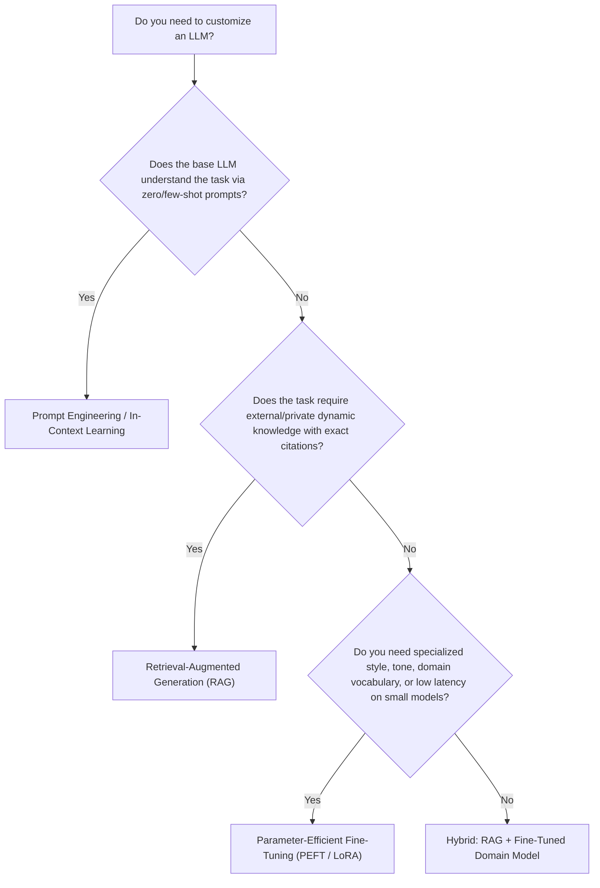

# Session 1: Fine-Tuning Introduction & Why Fine-Tune
**Module:** Fine-Tuning & Model Customization  
**Student Repository:** [https://github.com/dhruv-munjpara/fine_tuning](https://github.com/dhruv-munjpara/fine_tuning)

---

## 📌 Question 1: Difference Between Pre-Training and Fine-Tuning in LLMs
### Why do we need fine-tuning when pre-trained models already have vast knowledge?

### 1. Pre-Training vs Fine-Tuning Comparison

| Characteristic | Pre-Training (Self-Supervised) | Fine-Tuning (Supervised / Task-Specific) |
| :--- | :--- | :--- |
| **Objective** | Next token prediction / Masked language modeling over trillions of tokens. | Minimizing task-specific loss (e.g., cross-entropy for classification, instruction alignment). |
| **Data Scope** | Massive, unstructured web-scale corpora (Common Crawl, Wikipedia, books, code). | Curated, domain-specific, high-quality paired data (instructions/responses, labeled classes). |
| **Computational Cost**| Extremely high (millions of dollars, thousands of GPU/TPU hours). | Relatively low (minutes to hours on 1 or a few GPUs). |
| **Learned Capability**| Broad world knowledge, grammar, linguistic syntax, general reasoning. | Task adherence, specialized vocabulary, output formatting, safety constraints. |
| **Analogy** | Completing medical school + general education. | Completing a specialized cardiology residency. |

### 2. Why is Pre-Training Alone Not Enough?
Even though pre-trained models possess vast world knowledge, pre-training only equips the model to be a **general statistical pattern completer**, not an aligned assistant or domain specialist:
1. **Lack of Instruction & Format Alignment:** A raw pre-trained model prompted with *"Summarize this patient report"* might simply generate more fictional doctor notes instead of a structured summary, because its objective is text completion rather than following task constraints.
2. **Domain Dialects & Terminology Nuances:** General corpora do not capture nuanced internal nomenclatures, ICD-10 medical billing codes, specific corporate policies, or specialized legal terminology.
3. **Control over Stylistic Output:** Production applications require deterministic JSON schemas, specific tone of voice, or consistent classifications, which base models cannot reliably produce without targeted adaptation.
4. **Eliminating Irrelevant Pre-Training Biases:** Fine-tuning sharpens the attention weights towards specific cues necessary for specialized downstream tasks.

---

## 📌 Question 2: Practical Scenarios Where Pre-Trained Models Fail Without Domain Fine-Tuning

### Scenario 1: Healthcare & Clinical Diagnostic Coding (EHR / ICD-10)
* **Problem:** Medical records contain dense shorthand, physician abbreviations (e.g., *SOAP*, *bid*, *prn*, *CVA*), and specialized nomenclature. Pre-trained general models frequently conflate clinical abbreviations (e.g., *CVA* can mean *Cerebrovascular Accident* or *Costovertebral Angle*).
* **Why Pre-Trained Fails:** General LLMs lack grounding in clinical ontology and medical coding taxonomies (ICD-10-CM / CPT). They generate plausible-sounding medical assertions that are clinically invalid or produce invalid billing codes, creating severe compliance risks and patient safety hazards.
* **Why Fine-Tuning is Necessary:** Fine-tuning on verified clinical notes aligns the model's token embeddings with medical knowledge graphs, enforcing rigorous clinical accuracy and strict regulatory terminology.

### Scenario 2: Legal Contract Analysis & Regulatory Compliance (FinTech / Indian Corporate Law)
* **Problem:** Legal contracts (e.g., Non-Disclosure Agreements, Master Services Agreements, SEBI/RBI compliance disclosures) rely on strict statutory definitions where a single word (*"indemnify"* vs *"hold harmless"*, *"may"* vs *"shall"*) drastically alters contractual liabilities.
* **Why Pre-Trained Fails:** Pre-trained models treat legal clauses colloquially and exhibit hallucination when interpreting jurisdiction-specific clauses (e.g., Companies Act 2013 vs Delaware General Corporation Law). They fail to flag subtle non-standard indemnity obligations.
* **Why Fine-Tuning is Necessary:** Fine-tuning teaches the model the legal taxonomy, standard clause structures, and contract risk classifications required by enterprise legal teams.

### Scenario 3: Quantitative Finance & SEC / RBI Regulatory Filings (10-K, Earnings Calls)
* **Problem:** Financial sentiment and tabular financial statement reasoning are counter-intuitive compared to general English. For example, *"Operating expenses contracted by 12%"* has a negative word (*contracted*), but is financially **bullish/positive**. Conversely, *"Revenue increased by 2%, missing consensus estimates by 5%"* is **bearish/negative**.
* **Why Pre-Trained Fails:** Standard sentiment models trained on general text (movie reviews/tweets) misclassify financial statements because they rely on conventional sentiment adjectives rather than financial materiality and consensus expectations.
* **Why Fine-Tuning is Necessary:** Domain fine-tuning on earnings transcripts and financial news (e.g., FinBERT) aligns the model with financial polarity, tabular accounting structures, and market sensitivity.

---

## 📌 Question 3: Full Fine-Tuning vs Parameter-Efficient Fine-Tuning (PEFT)

| Dimension | Full Fine-Tuning (FFT) | Parameter-Efficient Fine-Tuning (PEFT / LoRA) |
| :--- | :--- | :--- |
| **Trainable Parameters** | 100% of all model weights (e.g., 66M for DistilBERT, 7B for LLaMA). | Typically **0.05% – 1.0%** of total weights (e.g., low-rank adapter matrices $A$ and $B$). |
| **GPU Memory Requirement** | **Extremely High:** Requires storing optimizer states (AdamW: 8 bytes/param), gradients (4 bytes/param), activations, and weights. 16–20× model size in VRAM. | **Very Low:** Base model weights are frozen; optimizer states and gradients are only maintained for adapter weights. Fits easily on consumer GPUs. |
| **Storage & Deployment** | Every fine-tuned task requires storing a full checkpoint (~14 GB for a 7B model). | Only adapter weights are stored (~10 MB to 50 MB per task). A single base model can serve hundreds of task adapters. |
| **Risk of Catastrophic Forgetting** | **High:** Overwriting all network weights causes the model to lose generalized reasoning, language fluency, and previously learned tasks. | **Extremely Low / None:** The original base model weights remain intact and immutable; specialized representations are isolated in adapter layers. |
| **Training Speed** | Slower backpropagation across all layers; higher gradient communication overhead. | Faster gradient computation; backpropagation stops at adapter injection points. |

---

## 📌 Question 4: Hugging Face Script – Model Architecture & Freezing Base Layers

The implementation is located in [`inspect_and_freeze_model.py`](file:///d:/DA%26DS/fine_tuning/session_1_introduction_and_why_finetune/inspect_and_freeze_model.py).

### Key Implementation Details:
1. **Model Loaded:** `distilbert-base-uncased` with a 2-label sequence classification head.
2. **Architecture Breakdown:**
   - **Embeddings Layer:** Word embeddings, position embeddings, and layer norm.
   - **Transformer Encoder:** 6 Transformer blocks (`distilbert.transformer.layer.0` to `5`), each with multi-head self-attention and feed-forward layers.
   - **Classification Head:** `pre_classifier` linear layer (768 $\rightarrow$ 768), ReLU activation, Dropout, and `classifier` linear layer (768 $\rightarrow$ 2).
3. **Freezing Mechanism:**
   ```python
   # Freeze all parameters in the base transformer
   for param in model.distilbert.parameters():
       param.requires_grad = False
   ```
4. **Parameter Verification:**
   - **Total Parameters:** ~66,955,010
   - **Trainable Parameters Before Freezing:** 66,955,010 (100.00%)
   - **Trainable Parameters After Freezing:** 592,130 (0.88%)
   - **Frozen Base Parameters:** 66,362,880 (99.12%)

---

## 📌 Question 5: When is Fine-Tuning NOT Recommended? (Decision Framework)

Fine-tuning is a powerful technique, but it is often misapplied when simpler, more cost-effective techniques yield superior results.

### 1. When NOT to Fine-Tune:
1. **Dynamic / Rapidly Changing Knowledge:** If your data changes hourly or daily (e.g., live stock prices, current sports scores, news), fine-tuning is obsolete upon completion. **Use RAG.**
2. **Direct Source Verification & Citations Required:** When users need direct citations and exact document page numbers for auditability (e.g., compliance, customer support policies). **Use RAG.**
3. **Small Sample Size / Low Budget:** When you only have 5–20 example prompts or limited compute budgets. Fine-tuning on insufficient data causes extreme overfitting. **Use Few-Shot Prompt Engineering.**
4. **General Reasoning or Standard Output:** When off-the-shelf instruction-tuned models (e.g., GPT-4o, Claude 3.5 Sonnet, Gemini 1.5 Pro) already execute the task with standard prompt formatting.

### 2. Strategic Decision Matrix: Prompt Engineering vs RAG vs Fine-Tuning



### 3. Trade-Off Evaluation Table

| Factor | Prompt Engineering | Retrieval-Augmented Generation (RAG) | Fine-Tuning (PEFT/LoRA) |
| :--- | :--- | :--- | :--- |
| **New Knowledge Acquisition** | None (Limited to prompt context window) | High (Dynamic retrieval from vector stores) | High (Static parametric memorization) |
| **Hallucination Risk** | Moderate | Very Low (Grounded on retrieved chunks) | Moderate to High (Can hallucinate plausible facts) |
| **Setup Cost & Complexity** | Minimal (Minutes, no infrastructure) | Moderate (Embeddings, Vector DB, Chunking pipeline) | High (Dataset curation, GPU training, evaluation) |
| **Latency per Request** | High (Long context tokens increase TTFT) | Moderate to High (Search latency + context tokens) | Low (Compact prompts, specialized small models) |
| **Best Used For** | Prototyping, zero-shot workflows, exploratory tasks. | Knowledge bases, FAQ bots, internal document search. | Style, tone, syntax enforcement, domain task adaptation. |
